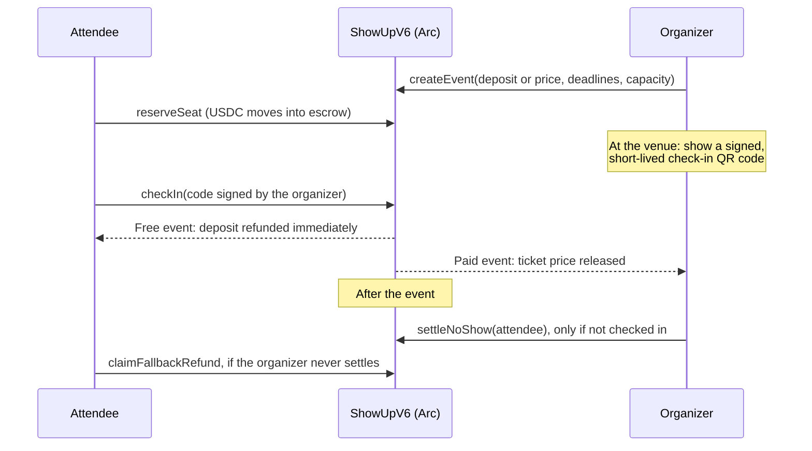
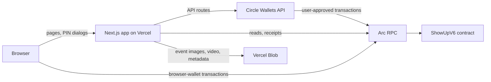

# ShowUp

**A programmable USDC commitment layer for accountable events on Arc.**

Free events lose a large share of their sign-ups to no-shows, and paid
events ask attendees to trust the organizer with their money. ShowUp puts
the commitment on-chain: attendees lock a small USDC deposit (free events)
or the ticket price (paid events) in a smart contract on Arc, check
themselves in at the venue, and get their deposit back automatically. If an
organizer never settles, every attendee can reclaim their funds after a
deadline, without anyone's permission.

> **Live app:** _add the production URL_ · **Demo video:** _add the link_ ·
> **Contract on Arc mainnet:** _add the explorer link after deployment_

## Why Arc

- **USDC is the native gas token.** Attendees and organizers hold one asset
  and never need to buy a separate gas token.
- **Sub-second finality.** A check-in at the door confirms before the next
  person reaches the front of the line.
- **Circle wallets on Arc.** People without a crypto wallet sign in with a
  Circle user-controlled wallet and approve each action with a PIN.

## How it works



| Event type | Attendee locks | Attended (checked in or confirmed) | No-show | Organizer never settles |
|---|---|---|---|---|
| Free | Deposit | Deposit back to the attendee | Deposit to the organizer | Attendee reclaims the deposit |
| Paid, pay in full | Ticket price | Price to the organizer | Price to the organizer | Attendee reclaims the price |
| Paid, deposit then balance | Deposit, then the balance before the payment deadline* | Price to the organizer | Price to the organizer | Attendee reclaims what was paid |

\* If the balance is not paid by the payment deadline, the seat is released
and the deposit goes to the organizer.

Attendees can cancel for a full refund until the cancellation deadline, and
every reservation is refundable if the organizer cancels the event.

## Features

- Free events with refundable commitment deposits; paid events with full or
  split payments; optional capacity limits.
- **Self check-in (new in V6).** The organizer shows a QR code signed with
  their wallet; attendees scan it and check in from their own wallet. A
  checked-in reservation can no longer be marked as a no-show.
- **Per-reservation cap (new in V6).** The contract enforces the maximum
  amount any single reservation can lock (100 USDC by default), which bounds
  what an attendee can lose to a dishonest organizer.
- **Public organizer record (new in V6).** Events created and cancelled,
  attendances, self check-ins, and no-shows settled with the amount
  collected, shown on every event page.
- Invite-only events with wallet-bound, signed invitations.
- Circle user-controlled wallets (PIN) and browser wallets (EIP-6963).
- No admin keys: nobody, including the deployer, can move escrowed funds.

## Architecture



- **One place for network settings.** `web/src/lib/showup-network.ts`
  holds the chain IDs, RPCs, explorer, token addresses and Circle chain
  codes for testnet and mainnet. `NEXT_PUBLIC_SHOWUP_NETWORK` selects one,
  and the app refuses to start if it or the contract address is missing.
- **One ABI.** `web/src/lib/showup-abi.ts` is generated from the compiled
  contract (`npm run sync-abi`). CI fails if it is stale, or if any contract
  call in the web app does not match it.
- **The chain is the source of truth.** After every transaction the UI
  re-reads on-chain state; a transaction hash alone is never treated as
  success. If the page reloads mid-transaction, it says so and keeps
  re-reading until the state settles.
- **No cross-network leaks.** Browser storage is namespaced by network and
  contract address.

## Repository layout

```
contracts/ShowUpV6.sol   Current contract
contracts/legacy/        Earlier versions (V1, V3, V5), kept for reference
contracts/test/          Mock USDC tokens used only by tests
test/ShowUpV6*.ts        V6 tests: unit, check-in, regression, security,
                         randomized invariants
test/legacy/             Tests for the earlier versions
ignition/                Deployment modules, parameters and deployment records
scripts/                 ABI sync, contract-call check, verification export
web/                     Next.js app and API routes
docs/                    Deployment runbook and submission notes
```

## Run locally

Requires Node.js 22.

```bash
# Contracts
npm ci
npm test                    # 127 tests, including randomized invariants

# Web app
cd web
npm ci
cp .env.example .env.local  # fill in the values
npm run dev
```

Deploying your own instance (contract, Circle, Vercel) is covered step by
step in [docs/DEPLOYMENT.md](docs/DEPLOYMENT.md).

## Security

The contract has no owner or admin, and funds can only move along the paths
in the table above. The organizer is still trusted to settle no-shows
honestly; self check-in, the per-reservation cap and the public organizer
record limit and expose that trust but do not remove it. See
[SECURITY.md](SECURITY.md) for the full trust model and known limitations.

Testing covers every settlement path, exact deadline boundaries, failure
paths (blocklisted USDC transfers, invalid signatures, failing batch
members), randomized operation sequences that re-check the escrow
accounting after every step, and Slither static analysis in CI.

## License

MIT
